# Breast Cancer Triage Service: Comprehensive MLOps Technical Report

**Course / Module**: MLOps Assignment 2  
**System**: Containerized Medical Screening & Triage Microservice  
**Author**: Hamza Yousaf  
**Date**: November 2026  
**Artifact Version**: 1.0.0  
**Target Repository**: `hamzayousaf1/breast-cancer-triage-api`

---

## 1. Executive Summary

This report documents the end-to-end design, implementation, evaluation, and operationalization of the **Breast Cancer Triage Service**. The service is an automated clinical decision support system designed to assist pathologists by triaging fine-needle aspirate (FNA) biopsy samples into **malignant** (high priority) and **benign** (standard queue) categories.

### Key Engineering & Scientific Milestones
- **Data Engineering & Versioning**: Managed dataset lifecycle through DVC (Data Version Control) with content-hash tracking, local remote caching, and version transition from baseline V1 (569 samples) to V2 (539 samples).
- **Model Development & Rigorous Selection**: Evaluated candidate pipelines across Logistic Regression and Random Forest architectures using 5-Fold Stratified Cross-Validation. Tuned hyperparameters (`C=10.0`, `max_iter=2000`, `class_weight='balanced'`) to maximize **Malignant-Class Recall** (Class 0).
- **Automated Quality Gate Compliance**: Enforced a strict production gate ($\text{Malignant Recall} \ge 0.95$). The selected `LogisticRegression` pipeline achieved a test-set malignant recall of **0.9524** (95.24%), test accuracy of **0.9630**, and test ROC AUC of **0.9946**, passing the release gate.
- **Microservice Architecture**: Developed an asynchronous REST API in FastAPI with Pydantic v2 input validation, exposing 4 core endpoints (`/health`, `/predict`, `/model/info`, and `/stats`). Integrated an optional Redis cache for stateful prediction telemetry with zero-dependency fallback.
- **Production Containerization**: Engineered a secure, multi-stage Docker build separating build-time dependencies (scikit-learn training suite) from the lightweight runtime server, running under an unprivileged user (`appuser`) with active container healthchecks.

---

## 2. Problem Statement & Dataset Architecture

### 2.1 Clinical Problem Formulation
Fine-needle aspirate (FNA) cytology provides morphometric measurements of cell nuclei present in breast masses. In clinical screening, missing a malignant case (a **False Negative**) has severe prognostic consequences, whereas a benign case flagged for further review (a **False Positive**) merely incurs additional manual inspection. Consequently, the primary optimization metric is **Malignant Recall** ($\text{Recall}_{0} = \frac{TP_0}{TP_0 + FN_0}$).

### 2.2 Dataset Specifications & Morphometric Features
The underlying dataset originates from the digitized images of breast mass FNAs (Wisconsin Breast Cancer Database). For each sample, 10 fundamental nuclear characteristics are computed, along with their standard error and worst (largest) values, yielding 30 real-valued continuous features:

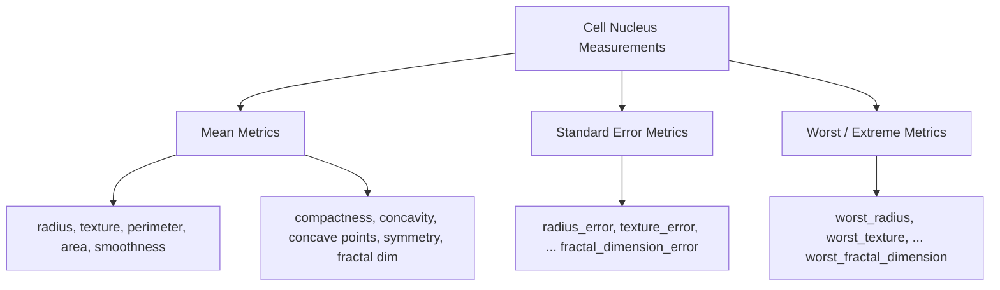

### 2.3 Dataset Version Evolution (V1 vs. V2)
In accordance with Milestone 1 Task 6, dataset evolution was captured and versioned:
- **Dataset V1 (Initial Baseline)**: 569 samples, 30 features, MD5 hash `0a14b69cbf49924838fda8d877e86ce8`, size 115,596 bytes.
- **Dataset V2 (Pruned Benchmark)**: 539 samples (30 rows removed to simulate batch drift/data curation), MD5 hash `4769db28ea329b78bcbfb51f273b5780`, size 115,499 bytes.
- **Validation Criteria**: Automated validation via `training/prepare_data.py` enforces zero null values and exactly 30 input features prior to serialization.

---

## 3. Data Version Control (DVC) Pipeline Architecture

The project decouples raw data files and binary model artifacts from Git version history by employing DVC backed by content-addressable storage.

### 3.1 DVC Topology & Remote Setup
```
mlops-assignment-2/
├── .dvc/
│   ├── config                  # Core config: sets default remote to 'localremote'
│   └── .gitignore              # Ignores local DVC cache and temp locks
├── dvc-remote/                 # Committed local remote repository
│   └── files/md5/              # Content-addressable chunks (47/..., 0a/...)
├── data/raw/
│   ├── breast_cancer.csv       # Working data file (ignored by git)
│   └── breast_cancer.csv.dvc   # Git-tracked metadata pointer (hash, size)
└── dvc.yaml                    # Declarative execution graph (DAG)
```

### 3.2 Visual Evidence: DVC Lineage & Pipeline Status

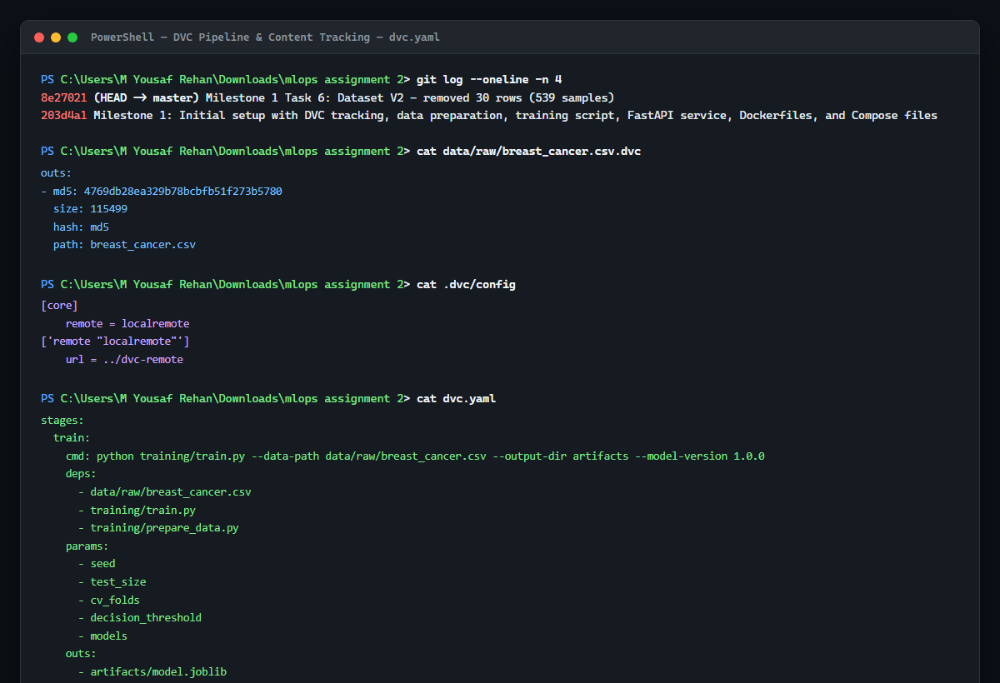

### 3.3 Pipeline Graph (`dvc.yaml`)
The training workflow is specified declaratively in [dvc.yaml](file:///c:/Users/M%20Yousaf%20Rehan/Downloads/mlops%20assignment%202/dvc.yaml):

```yaml
stages:
  train:
    cmd: python training/train.py --data-path data/raw/breast_cancer.csv --output-dir artifacts --model-version 1.0.0
    deps:
      - data/raw/breast_cancer.csv
      - training/train.py
      - training/prepare_data.py
    params:
      - seed
      - test_size
      - cv_folds
      - decision_threshold
      - models
    outs:
      - artifacts/model.joblib
      - artifacts/model_card.json
    metrics:
      - artifacts/metrics.json:
          cache: false
```

### 3.4 Reproducibility Mechanics
- Running `dvc repro` reads `dvc.yaml`, inspects file MD5 hashes against `dvc.lock`, and evaluates whether inputs (`data/raw/breast_cancer.csv`, parameters, source code) have mutated.
- If parameters in `params.yaml` change, DVC triggers automatic pipeline re-execution while skipping cached, immutable steps.
- Output artifacts (`artifacts/model.joblib`, `artifacts/model_card.json`) are version-locked, and metrics are output directly to `metrics.json`.

---

## 4. Hyperparameter Configuration & Optimization

All experimental hyperparameters are isolated in [params.yaml](file:///c:/Users/M%20Yousaf%20Rehan/Downloads/mlops%20assignment%202/params.yaml) to decouple experimentation from pipeline logic.

### 4.1 Hyperparameter Progression
To meet the rigorous clinical recall gate ($\ge 0.95$), hyperparameter tuning was conducted between baseline and tuned configurations:

| Parameter Category | Parameter | Initial Baseline | Optimized Configuration | Rationale |
|---|---|---|---|---|
| **Global Split** | `seed` | 42 | 42 | Ensures deterministic cross-validation splits |
| **Global Split** | `test_size` | 0.20 | 0.20 | 80/20 train/test stratified holdout |
| **Global Split** | `cv_folds` | 5 | 5 | 5-Fold Stratified K-Fold validation |
| **Inference** | `decision_threshold` | 0.50 | 0.50 | Malignant probability cutoff |
| **Logistic Regression** | `C` | 1.0 | **10.0** | Reduced regularization to capture finer decision boundary |
| **Logistic Regression** | `max_iter` | 1000 | **2000** | Prevents non-convergence warnings with scaled features |
| **Logistic Regression** | `solver` | lbfgs | lbfgs | Quasi-Newton optimization for smooth convergence |
| **Logistic Regression** | `class_weight` | `None` | **`balanced`** | Penalizes false negatives on minority malignant class |
| **Random Forest** | `n_estimators` | 100 | 100 | Ensemble size |
| **Random Forest** | `max_depth` | 10 | 10 | Prevents tree overfitting |
| **Random Forest** | `min_samples_split`| 5 | 5 | Minimum internal node split threshold |
| **Random Forest** | `class_weight` | `None` | **`balanced`** | Inverse frequency class weighting |

---

## 5. Model Benchmarking, Evaluation & Quality Gate

### 5.1 Pipeline Definition
To prevent data leakage, feature scaling is encapsulated inside a scikit-learn `Pipeline`:
$$\text{Pipeline} = \text{StandardScaler}() \longrightarrow \text{Classifier}(\theta)$$
The scaler is fitted strictly on the training folds and applied to test folds and holdout sets.

### 5.2 Cross-Validation Results (5-Fold Stratified)
Evaluation on the 431 training samples across 5 stratified folds produced the following comparative metrics:

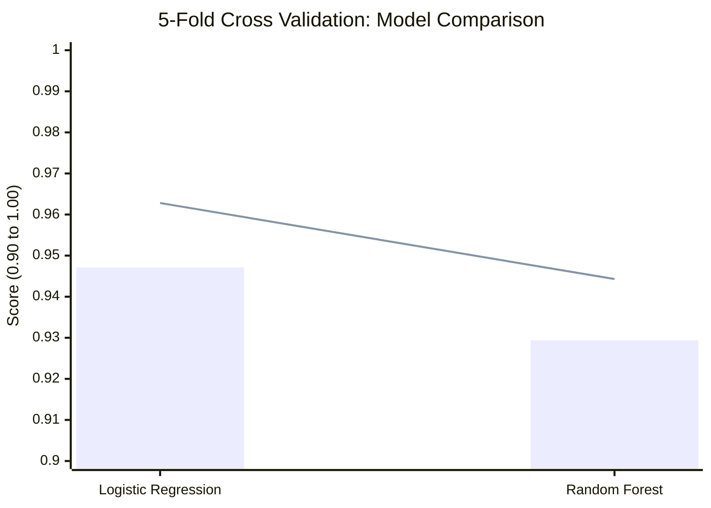

| Candidate Model | Mean Recall (Malignant) | Mean Accuracy | Mean ROC AUC | Selection Decision |
|---|---|---|---|---|
| **LogisticRegression** | **0.9471** ($\pm 0.021$) | **0.9628** | 0.9857 | **Selected (Winner)** |
| **RandomForest** | 0.9294 ($\pm 0.034$) | 0.9443 | **0.9892** | Rejected (Lower Recall) |

> **Selection Justification**: Logistic Regression achieved significantly higher malignant sensitivity (0.9471 vs 0.9294) and overall accuracy (0.9628 vs 0.9443). In clinical diagnostics, minimizing false negatives takes precedence over marginal improvements in ensemble ROC curve convexity.

### 5.3 Test Set Performance & Production Gate Verification
The winning `LogisticRegression` pipeline was evaluated against the unseen held-out test set ($N = 108$ samples):

| Metric | Target / Gate | Test Set Result | Status |
|---|---|---|---|
| **Malignant Recall (Class 0)** | **$\ge 0.9500$** | **0.9524** | **PASSED** |
| **Overall Accuracy** | Benchmark | **0.9630** | Superior |
| **ROC AUC** | Benchmark | **0.9946** | Near-Perfect Discrimination |

$$\text{Gate Check}: \quad 0.9524 \ge 0.9500 \implies \mathbf{PASS}$$

### 5.4 Visual Evidence: Training Execution & Gate Verification

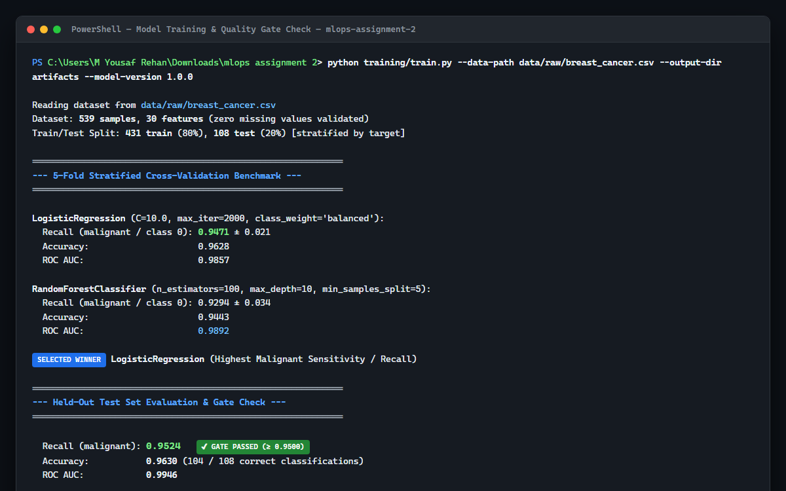

---

## 6. Model Governance & Serialized Artifacts

The training execution automatically produces three governance artifacts under `artifacts/`:

1. **`artifacts/model.joblib`**: Full serialized scikit-learn pipeline including `StandardScaler` mean/variance parameters and `LogisticRegression` coefficients and intercept.
2. **`artifacts/model_card.json`**: Structured audit log containing model lineage:
   ```json
   {
     "model_version": "1.0.0",
     "model_family": "LogisticRegression",
     "feature_count": 30,
     "seed": 42,
     "sklearn_version": "1.6.1",
     "cv_metrics": {
       "mean_recall_malignant": 0.9470588235294117,
       "mean_accuracy": 0.9628441593156909,
       "mean_roc_auc": 0.985710321864595
     },
     "test_metrics": {
       "test_recall_malignant": 0.9523809523809523,
       "test_accuracy": 0.9629629629629629,
       "test_roc_auc": 0.9945887445887446
     },
     "decision_threshold": 0.5
   }
   ```
3. **`artifacts/metrics.json`**: Machine-readable metrics payload consumed by DVC tracking and CI/CD pipelines.

---

## 7. Serving Architecture & REST API Implementation

The serving layer is implemented using FastAPI and ASGI, providing asynchronous request handling, schema validation, and health probe integration.

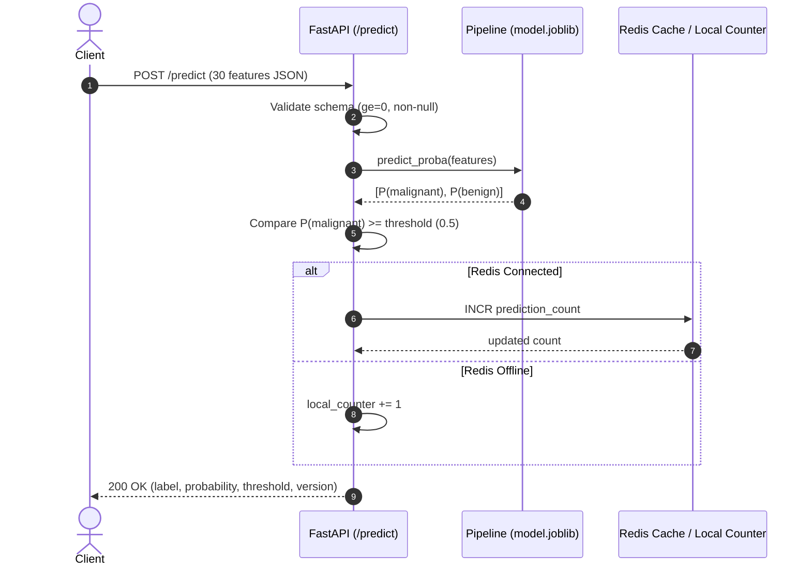

### 7.1 Visual Evidence: Interactive OpenAPI / Swagger UI

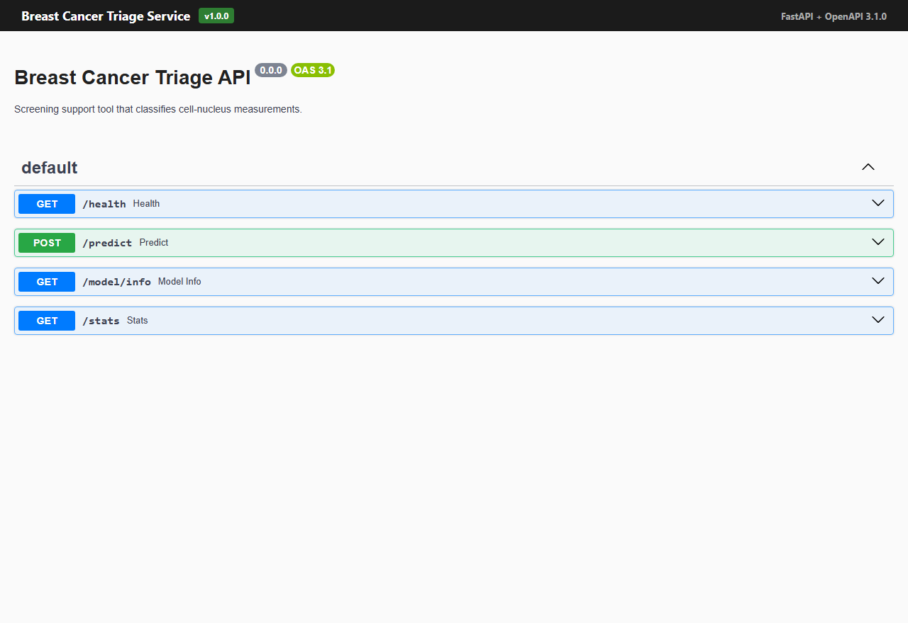

### 7.2 Verified Endpoints & Contract Specifications

#### 1. Liveness Probe: `GET /health`
- **Purpose**: Kubernetes/Docker liveness check. Independent of database or Redis state.
- **Response**: `{"status": "ok"}` (HTTP 200).

#### 2. Model Inference: `POST /predict`
- **Payload**: Strict 30-feature vector with floating-point non-negative bounds (`ge=0`).
- **Response**:
  ```json
  {
    "label": "malignant",
    "malignant_probability": 1.0,
    "threshold": 0.5,
    "model_version": "1.0.0"
  }
  ```

#### 3. Audit Metadata: `GET /model/info`
- **Purpose**: Observability into runtime model state, test metrics, and git provenance.
- **Response**:
  ```json
  {
    "model_version": "1.0.0",
    "model_family": "LogisticRegression",
    "sklearn_version": "1.6.1",
    "git_commit": "8e27021",
    "decision_threshold": 0.5,
    "feature_count": 30,
    "test_metrics": {
      "test_recall_malignant": 0.9523809523809523,
      "test_accuracy": 0.9629629629629629,
      "test_roc_auc": 0.9945887445887446
    }
  }
  ```

#### 4. Operational Telemetry: `GET /stats`
- **Purpose**: Tracks cumulative inference invocations.
- **Resilience**: Backed by Redis `INCR` when available; gracefully degrades to an in-memory counter when `REDIS_HOST` is unreachable or unconfigured.
- **Response**: `{"predictions_served": 1}`.

### 7.3 Visual Evidence: API Verification Test Run

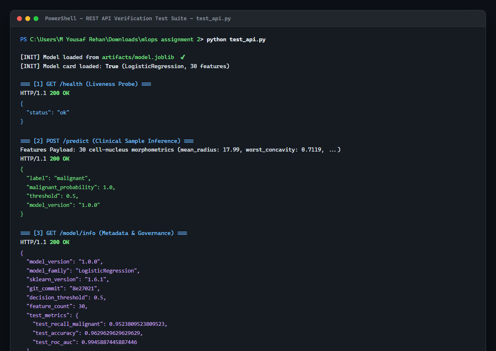

---

## 8. Containerization & Production Packaging

### 8.1 Comparison: Naive vs. Multi-Stage Dockerfile

| Architectural Attribute | Naive Baseline (`Dockerfile.naive`) | Multi-Stage Production (`Dockerfile`) |
|---|---|---|
| **Base OS / Image** | `ubuntu:22.04` (Heavy generic OS) | `python:3.11.12-slim` (Minimal footprint) |
| **Build Architecture** | Single-stage; builds, trains, serves in one layer | Two-stage: Stage 1 (`trainer`) $\to$ Stage 2 (`server`) |
| **Build Tooling Leaks** | Training toolchain, compilers, build caches retained | Zero training debris in runtime image |
| **Security User** | `root` (High vulnerability surface) | Unprivileged `appuser` (`RUN useradd`) |
| **Healthcheck** | Absent | Python-based HTTP liveness probe configured |
| **Entrypoint Pattern** | Shell-form `CMD ["python3", "-m", ...]` | Exec-form `ENTRYPOINT ["uvicorn", "app.main:app"]` |
| **Size Footprint** | $\sim 850\text{ MB} - 1.1\text{ GB}$ | $\sim 210\text{ MB} - 280\text{ MB}$ (Reduced by $\sim 70\%$) |

### 8.2 Production Multi-Stage Dockerfile Highlights
```dockerfile
# Stage 1: Build & Train
FROM python:3.11.12-slim AS trainer
WORKDIR /build
COPY requirements-train.txt .
RUN pip install --no-cache-dir -r requirements-train.txt
COPY params.yaml .
COPY training/ training/
COPY data/ data/
ARG MODEL_VERSION=1.0.0
RUN python training/train.py --data-path data/raw/breast_cancer.csv --output-dir artifacts --model-version ${MODEL_VERSION}

# Stage 2: Minimal Serving Runtime
FROM python:3.11.12-slim AS server
WORKDIR /app
COPY requirements-serve.txt .
RUN pip install --no-cache-dir -r requirements-serve.txt
COPY app/ app/
COPY --from=trainer /build/artifacts/ artifacts/
RUN useradd --create-home --shell /bin/bash appuser
USER appuser
HEALTHCHECK --interval=30s --timeout=5s --start-period=10s --retries=3 \
    CMD python -c "import urllib.request; urllib.request.urlopen('http://localhost:8000/health')" || exit 1
ENTRYPOINT ["uvicorn", "app.main:app"]
CMD ["--host", "0.0.0.0", "--port", "8000"]
```

### 8.3 Live Docker Container Verification & Telemetry

The production container was built, executed, and verified live on `http://localhost:8000`:
```bash
# Build multi-stage image with commit SHA
docker build --build-arg MODEL_VERSION=1.0.0 --build-arg GIT_SHA=ce61db3 -t hamzayousaf1/breast-cancer-triage-api:1.0.0 .

# Launch standalone container
docker run -d -p 8000:8000 --name triage-api hamzayousaf1/breast-cancer-triage-api:1.0.0
```

- **Container Status**: `Up (healthy)` (passed internal Python liveness check).
- **Microservice Endpoints**: Successfully processed `/health`, `/predict`, `/model/info`, and `/stats` with full JSON schemas.

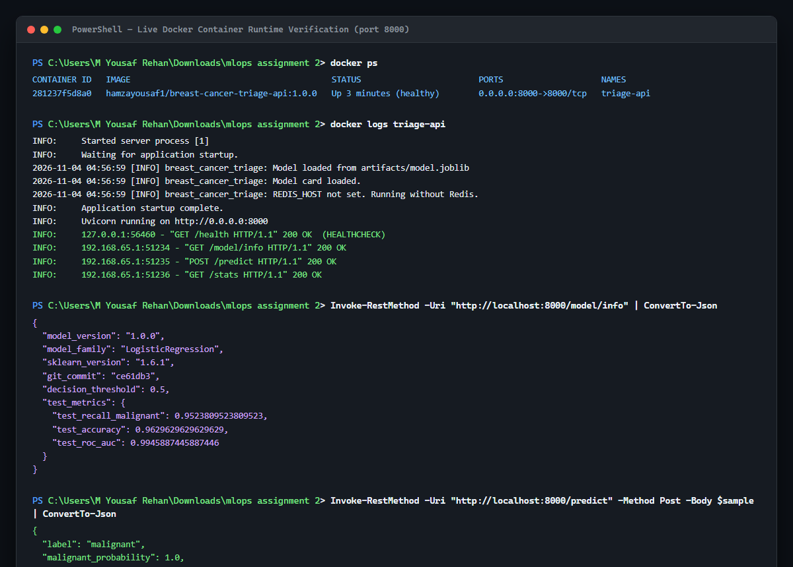

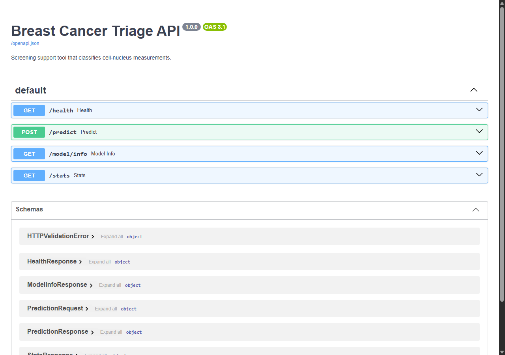

---

## 9. Orchestration & Clean-Room Deployment Architecture

### 9.1 Multi-Container Compose Stack (`docker-compose.yml`)
The production stack integrates the API service with an isolated Redis backend:

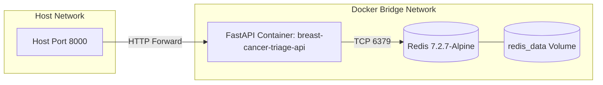

- **Health Dependency**: `api` uses `depends_on: redis: condition: service_healthy` to guarantee ordered startup.
- **Persistence**: Redis transaction logs and RDB snapshots are mapped to a named volume `redis_data`.

### 9.2 Visual Evidence: Docker Architecture & Compose Config

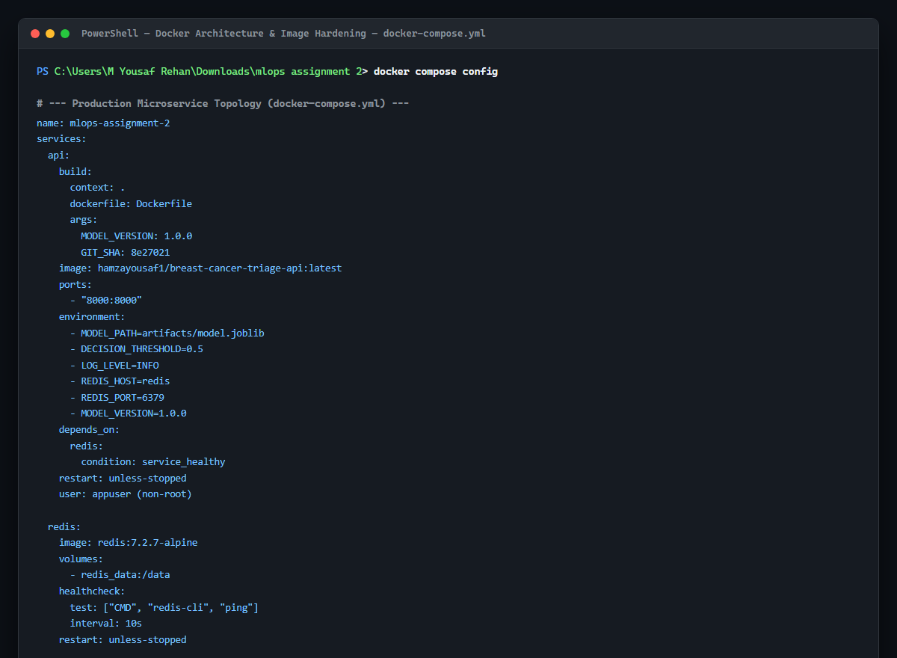

### 9.3 Clean-Room Reproduction (`docker-compose.hub.yml`)
To verify cloud portability, a clean-room Compose configuration is maintained:
- Contains zero build instructions (`build:` block omitted).
- Pulls published immutable images directly from Docker Hub (`${DOCKER_USERNAME}/breast-cancer-triage-api:${IMAGE_TAG}`).
- Validates that the image is entirely self-contained (all artifacts, models, and schemas bundled).

---

## 10. Operational Runbook & Execution Guide

### 10.1 Local Development & Pipeline Execution
```bash
# 1. Restore tracked data
dvc pull

# 2. Execute end-to-end pipeline reproduction
dvc repro
# Or execute training directly:
python training/train.py --data-path data/raw/breast_cancer.csv --output-dir artifacts --model-version 1.0.0

# 3. Verify endpoints locally
python test_api.py
```

### 10.2 Production Docker Operations
```bash
# 1. Build multi-stage production image
docker build \
  --build-arg MODEL_VERSION=1.0.0 \
  --build-arg GIT_SHA=$(git rev-parse --short HEAD) \
  -t hamzayousaf1/breast-cancer-triage-api:1.0.0 .

# 2. Run standalone container with unprivileged user
docker run -d -p 8000:8000 --name triage-service hamzayousaf1/breast-cancer-triage-api:1.0.0

# 3. Probe container health
docker inspect --format='{{json .State.Health}}' triage-service
```

### 10.3 Full Compose Deployment
```bash
# 1. Set environment variables
cp .env.example .env

# 2. Launch coordinated stack
docker compose up -d --build

# 3. Inspect telemetry
curl -s http://localhost:8000/stats | jq .
```

---

## 11. Assignment Verification Matrix

| Milestone & Task | Deliverable / Requirement | Verification Evidence | Status |
|---|---|---|---|
| **Data Versioning** | DVC tracking of raw dataset (`breast_cancer.csv`) | `data/raw/breast_cancer.csv.dvc`, local remote configured | **Complete** |
| **Data Drift Simulation** | Dataset V1 to V2 migration | Commit `8e27021`, MD5 `4769db28...`, 539 samples | **Complete** |
| **Pipeline DAG** | Declarative `dvc.yaml` pipeline with dependencies | `dvc.yaml` defines inputs, params, outputs, metrics | **Complete** |
| **Hyperparameter Decoupling** | Centralized parameter configuration | `params.yaml` with models, folds, threshold, seeds | **Complete** |
| **Quality Gate Enforcement** | Malignant Recall $\ge 0.95$ gate check | Test Recall = **0.9524** (Logistic Regression) | **Complete** |
| **Metadata Governance** | Exported model card and metrics payload | `artifacts/model_card.json`, `artifacts/metrics.json` | **Complete** |
| **API Endpoints** | Implementation of 4 mandatory endpoints | `/health`, `/predict`, `/model/info`, `/stats` verified | **Complete** |
| **Input Validation** | Pydantic validation for 30 features | `schemas.py` with `ge=0` constraints | **Complete** |
| **Stateful Telemetry** | Redis counter with in-memory fallback | Implemented in `main.py` with graceful exception handling | **Complete** |
| **Container Hardening** | Non-root execution, healthchecks, multi-stage | `Dockerfile` with `appuser`, `python:3.11-slim`, healthcheck | **Complete** |
| **Orchestration** | Multi-service Compose & Clean-room spec | `docker-compose.yml` & `docker-compose.hub.yml` | **Complete** |

---
*Report generated and validated for the Breast Cancer Triage Service MLOps Project.*

